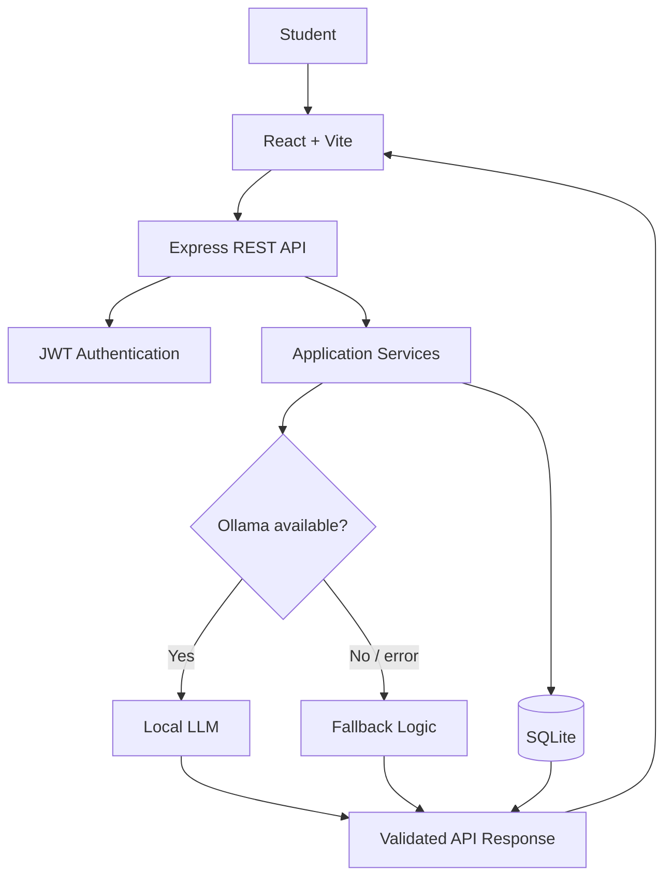

# 🧠 StudyBuddy

### AI-Assisted Study Planning & Academic Progress Tracking

<p align="center">
  
  
  
  
  
  
</p>

<p align="center"><strong>Study Smarter. Stay Consistent. Panic Less. 🎯</strong></p>

<p align="center">
  <a href="https://studybuddy-nyrg.onrender.com/">🌐 Live Application</a> ·
  <a href="https://github.com/rajrohit5783-cmyk/StudyBuddy">📦 Source Code</a>
</p>

---

## ✨ What is StudyBuddy?

StudyBuddy is a full-stack academic productivity application that helps students organize subjects, plan study sessions, monitor learning progress, revise with flashcards, generate quizzes, and get conversational study support.

It combines a React interface, an Express API, persistent SQLite storage, and optional local AI through Ollama. When local AI is unavailable, selected workflows continue through deterministic or predefined fallback logic.

**The learning loop:** Plan → Focus → Track → Revise → Improve.

## 📸 Application Preview

### Dashboard
A central overview of study activity, subject progress, focus time, sessions, and upcoming exams.


### Personalized Study Plan
A day-by-day schedule based on study availability and subject priorities.


### AI Study Coach
A chat interface for explanations, study guidance, and revision support.


> **Screenshot assets:** These previews use repository-relative paths. Add the three image files under `docs/images/` with the exact names shown above for GitHub to render them.

---

## 🚀 Core Features

| Module | What it does |
|---|---|
| **Dashboard** | Summarizes study time, sessions, completed topics, flashcards due, and upcoming exams |
| **Subjects & Topics** | Organizes subjects, exam dates, difficulty, confidence, and topic completion |
| **Study Planner** | Generates a multi-day schedule using local AI or an algorithmic fallback |
| **Pomodoro / Focus** | Supports focused study sessions and records completed study time |
| **Flashcards** | Creates revision cards and schedules reviews using interval/ease values |
| **Quiz** | Generates multiple-choice questions with explanations; uses fallback questions if AI generation fails |
| **AI Study Coach** | Provides conversational study guidance using Ollama with a fallback response |
| **Documents** | Accepts PDF uploads, extracts text, and can create flashcards from extracted content |
| **Analytics** | Reports total study minutes, sessions, streak, weekly activity, and subject progress |
| **Calendar Export** | Exports the latest study plan as an `.ics` calendar file |
| **Theme** | Offers light and dark appearance options |

## 🧰 Technology Stack

### Frontend
- **React 18** — component-based user interface
- **Vite 5** — development server and production build tooling
- **JavaScript (ES modules)** — application logic
- **CSS** — layout, responsive styling, and themes
- **Lucide React** — interface icons

### Backend
- **Node.js (>= 22.5)** — server runtime
- **Express 4** — REST API
- **JWT / jsonwebtoken** — token-based authentication
- **bcryptjs** — password hashing
- **Multer** — PDF upload handling
- **pdf-parse** — PDF text extraction
- **Helmet** — HTTP security headers
- **CORS** — allowed-origin control
- **express-rate-limit** — request throttling
- **dotenv** — environment configuration

### Data & AI
- **SQLite via Node's built-in `node:sqlite`** — persistent application data
- **Ollama** — optional local model runtime
- **Llama 3.2 1B** — default configured model (`llama3.2:1b`)
- **Algorithmic planner** — deterministic study-plan fallback

---

## 🏛️ Architecture



**Request lifecycle**
1. The React client sends an HTTP request to the Express API.
2. Protected routes verify the bearer token and scope records to the authenticated user.
3. The backend reads or updates application state through the SQLite store.
4. AI-enabled features attempt to call the configured Ollama endpoint.
5. Where implemented, fallback logic provides a response if AI is unavailable.
6. The API returns JSON to the frontend.

## 🧠 Study Planner Logic

The planner has two paths:

- **Local AI path:** sends the user's subjects and planning constraints to Ollama and requests a JSON schedule.
- **Algorithmic fallback:** ranks subjects and allocates study slots without depending on an AI service.

The fallback priority score in `server/planner.js` is:

```text
priority = 100 / (daysUntilExam + 2)
         + (100 - confidence) * 0.65
         + difficultyScore
         + unfinishedTopicCount * 2
```

Difficulty contribution:
- Easy: 0
- Medium: 8
- Hard: 16

The planner clamps the requested horizon to 1–30 days and the daily time budget to 15–1440 minutes. It prioritizes exam proximity, lower confidence, harder subjects, and unfinished topics. If no unfinished topic remains for a subject, the fallback can schedule a revision slot.

## 🗃️ Data Storage

The backend store is implemented in `server/store.js`.

- SQLite database file: `data/studybuddy.sqlite` by default.
- Table: `app_state`, containing the serialized application state.
- SQLite WAL mode and a busy timeout are enabled.
- On first initialization, an existing `data/db.json` can be migrated into the SQLite state record.

The application state contains user, subject, session, flashcard, chat, quiz, document, and plan records. User-owned records are filtered by the authenticated user ID in the API.

## 🔌 API Reference

All routes below are implemented in `server/index.js`. Routes marked **Protected** require a bearer token.

### Health & Authentication

| Method | Endpoint | Access | Purpose |
|---|---|---|---|
| GET | `/api/health` | Public | Checks API and Ollama availability |
| POST | `/api/auth/register` | Public | Creates an account |
| POST | `/api/auth/login` | Public | Authenticates and returns a token |
| GET | `/api/auth/me` | Protected | Returns the current user |
| GET | `/api/bootstrap` | Protected | Loads the user's application collections |

### Subjects & Planning

| Method | Endpoint | Access | Purpose |
|---|---|---|---|
| GET | `/api/subjects` | Protected | Lists subjects |
| POST | `/api/subjects` | Protected | Creates a subject |
| PUT | `/api/subjects/:id` | Protected | Updates a subject and topic progress |
| DELETE | `/api/subjects/:id` | Protected | Deletes a subject |
| POST | `/api/plan` | Protected | Generates and saves a study plan |
| GET | `/api/calendar.ics` | Protected | Exports the latest plan as an iCalendar file |

### Study, Revision & AI

| Method | Endpoint | Access | Purpose |
|---|---|---|---|
| POST | `/api/sessions` | Protected | Records a completed study session |
| DELETE | `/api/sessions/:id` | Protected | Deletes a study session |
| GET | `/api/flashcards` | Protected | Lists flashcards |
| POST | `/api/flashcards` | Protected | Creates a flashcard |
| POST | `/api/flashcards/:id/review` | Protected | Records a review and updates its interval |
| POST | `/api/quiz` | Protected | Generates quiz questions |
| POST | `/api/coach` | Protected | Returns a study-coach response |

### Documents & Analytics

| Method | Endpoint | Access | Purpose |
|---|---|---|---|
| POST | `/api/documents` | Protected | Uploads a PDF and extracts its text |
| POST | `/api/documents/:id/flashcards` | Protected | Creates flashcards from an uploaded document |
| GET | `/api/analytics` | Protected | Returns study analytics |

**Authentication header**

```http
Authorization: Bearer <your-jwt-token>
```

---

## ⚙️ Run Locally

### Prerequisites
- Node.js **22.5 or newer**
- npm
- Git
- Ollama (optional; required for local LLM responses)

### 1. Clone the repository

```bash
git clone https://github.com/rajrohit5783-cmyk/StudyBuddy.git
cd StudyBuddy
```

### 2. Install dependencies

```bash
npm install
```

### 3. Configure environment variables

Create a `.env` file in the project root:

```env
PORT=8787
NODE_ENV=development
JWT_SECRET=replace_with_a_long_random_secret_of_at_least_32_characters
OLLAMA_URL=http://127.0.0.1:11434
OLLAMA_MODEL=llama3.2:1b
DATA_DIR=./data
UPLOAD_DIR=./uploads
MAX_UPLOAD_MB=10
CORS_ORIGINS=http://localhost:5173
```

In production, `JWT_SECRET` must be at least 32 characters. Keep the real secret private and do not commit `.env`.

### 4. (Optional) Enable local AI

Install Ollama from [ollama.com](https://ollama.com/), then pull the configured model:

```bash
ollama pull llama3.2:1b
```

Make sure the Ollama service is running. If it is not available, the application can use its implemented fallback behavior for supported features.

### 5. Start the application

```bash
npm run dev
```

The development script starts Vite and the Express server concurrently.

| Service | Default URL |
|---|---|
| Frontend | http://localhost:5173 |
| Backend | http://localhost:8787 |
| Health check | http://localhost:8787/api/health |

### Other useful commands

```bash
npm run server    # Start the backend only
npm run build     # Build the frontend for production
npm run preview   # Preview the Vite production build
npm start         # Start the Express server
npm test          # Run automated tests
npm run check     # Syntax-check server files and run tests
```

## 🧪 Testing

Run the automated test suite:

```bash
npm test
```

Run the project's combined check:

```bash
npm run check
```

The repository includes tests for the algorithmic planner. The test command uses Node's built-in test runner.

## 🔐 Security & Reliability

- Passwords are hashed with bcryptjs before storage.
- Protected API routes use JWT verification.
- Data access is scoped to the authenticated user.
- Helmet configures HTTP security headers.
- CORS is restricted to configured origins.
- Rate limits are applied to API and authentication requests.
- PDF uploads have a configurable size limit and PDF MIME/signature checks.
- Ollama requests use a timeout.
- Production startup rejects a missing or weak JWT secret.

**Deployment note:** Configure persistent storage for the SQLite database and uploaded files in your hosting environment. Configure `CORS_ORIGINS`, `JWT_SECRET`, and other environment variables in the hosting dashboard rather than committing secrets.

## 📁 Repository Structure

```text
StudyBuddy/
├── public/                 # Static public assets
├── src/                    # React application source
│   ├── main.jsx
│   └── styles.css
├── server/
│   ├── index.js            # Express API, auth and application routes
│   ├── planner.js          # Algorithmic study planner
│   └── store.js            # SQLite persistence layer
├── tests/
│   └── planner.test.js     # Planner tests
├── docs/
│   └── images/             # README screenshots
├── data/                   # Runtime database directory
├── uploads/                # Runtime PDF upload directory
├── index.html
├── vite.config.js
├── package.json
└── README.md
```

Runtime data directories and local environment files should remain out of version control.

## 🛣️ Future Improvements

Ideas for future iterations:
- Expanded learning analytics and progress visualizations
- More configurable spaced-repetition controls
- Study reminders and calendar synchronization
- More AI model/provider options
- Broader automated API and end-to-end test coverage
- Additional accessibility and mobile usability improvements

## 👥 Project Team

**Major Project — JECRC University, Jaipur, Rajasthan, India**

| Team Member | Registration Number |
|---|---|
| Vivek Rankawat | 25BCON2395 |
| Rohit Raj | 25BCON1900 |
| Rudraksh Pitti | 25BCON2488 |

**Under the Supervision of:** Harshit Gupta  
**Designation:** AI Trainer

## 🙏 Acknowledgements

We thank our project supervisor, **Harshit Gupta**, for his guidance and support. We also acknowledge the open-source communities and maintainers behind React, Vite, Node.js, Express, SQLite, and Ollama.

---

<p align="center">
  <strong>“Small, consistent sessions beat last-minute panic.”</strong>
  <br />
  Made with 💜 by the StudyBuddy Team
</p>
