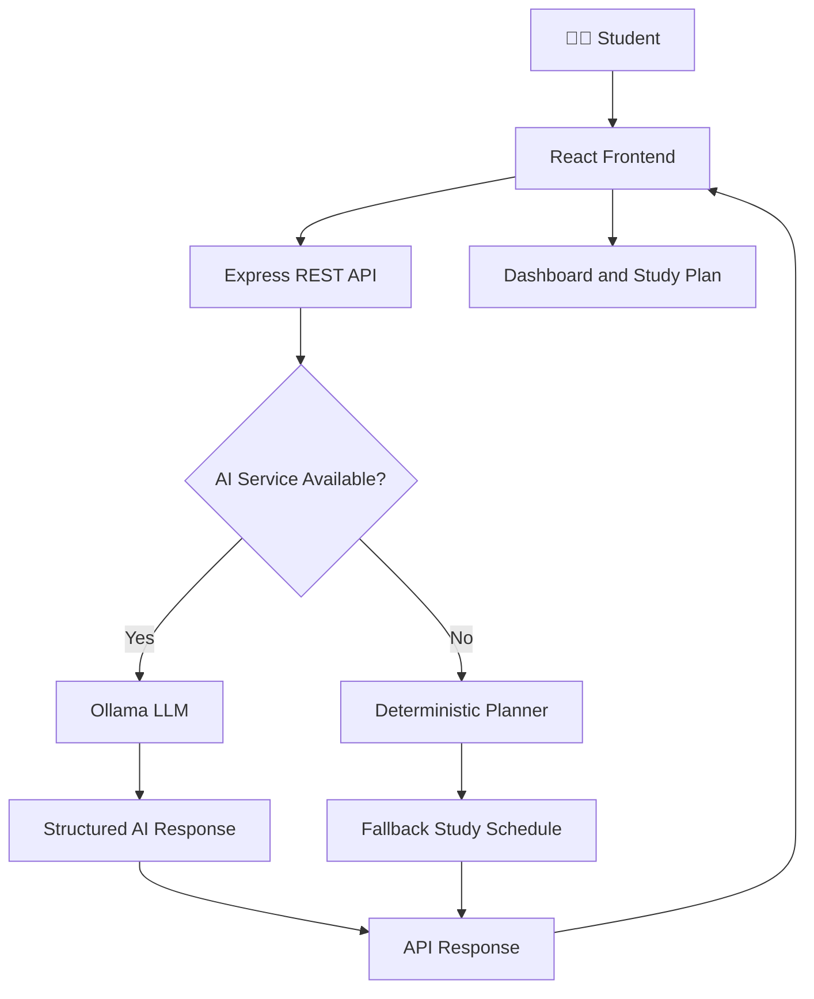

# 🧠 StudyBuddy
###       AI-Powered Study Planning & Progress Tracking Platform

<p align="center">
  <strong>Study smarter. Stay consistent. Panic less. 🚀</strong>
</p>

<p align="center">
  An intelligent academic productivity platform designed to help students organize their syllabus, generate personalized study schedules, track learning progress, and get AI-powered study assistance.
</p>

<p align="center">
  
  
  
  
  
</p>

---

## 🌐 Overview

**StudyBuddy** is a full-stack academic productivity application built to solve one of the most common student problems: knowing what to study, when to study it, and how to stay consistent.

Traditional to-do lists help students remember tasks, but they don't necessarily help prioritize subjects, manage examination deadlines, or identify topics that require additional attention.

StudyBuddy brings these capabilities together in one platform.

With an interactive dashboard, intelligent scheduling, topic-level progress tracking, and an AI-powered study coach, StudyBuddy aims to make academic preparation more organized and manageable.

## ✨ Key Features

| Feature | Description |
|---|---|
| 📊 Interactive Dashboard | View study summaries, preparation progress and upcoming examinations. |
| 📚 Subject Management | Add subjects, examination dates, difficulty levels and syllabus topics. |
| 🤖 AI Study Planner | Generate structured study schedules using an AI-assisted planning workflow. |
| 🧠 AI Study Coach | Ask academic questions and receive AI-generated study guidance. |
| 📈 Progress Tracking | Monitor completed topics and subject-level preparation. |
| 🎯 Weak Topic Detection | Identify topics that may require additional revision using a confidence-based heuristic. |
| ⏱️ Pomodoro Timer | Support focused study sessions. |
| 🗂️ Flashcards | Provide a revision-oriented learning module. |
| 📝 Quiz Generation API | Generate multiple-choice questions through the backend AI integration. |
| 🌙 Theme Customization | Switch between light and dark appearances. |
| 📱 Responsive Interface | Access the application through desktop and smaller-screen layouts. |

## 🖥️ Application Preview

### Dashboard

The central workspace provides an overview of academic preparation, study activity, and quick actions.


### AI-Generated Study Plan

StudyBuddy organizes subjects and topics into scheduled study sessions, considering available study time and academic priorities.


### AI Study Coach

The AI Coach provides an interactive interface for asking questions, understanding concepts, and seeking study recommendations.


---

## ⚙️ Technology Stack

StudyBuddy combines modern frontend technologies, backend development, and local AI integration.

### Frontend

| Technology | Purpose |
|---|---|
| React.js | Component-based user interface |
| Vite | Development server and frontend build tooling |
| HTML5 | Application structure |
| CSS3 | Styling and responsive layouts |
| JavaScript | Application logic and interactions |

### Backend

| Technology | Purpose |
|---|---|
| Node.js | JavaScript runtime environment |
| Express.js | REST API and backend routing |
| REST API | Communication between frontend and backend |
| JSON | Request and response data format |

### Artificial Intelligence

| Technology | Purpose |
|---|---|
| Ollama | Local language-model integration |
| Llama 3.2 (1B) | Default configured AI model |
| AI-assisted planning | Structured study schedule generation |
| AI Coach | Academic assistance and explanations |
| Fallback algorithm | Rule-based scheduling when AI is unavailable |

### Additional Technologies

- Browser localStorage for browser-side preferences and study data in the local-first implementation.
- Node.js built-in test runner for planner testing.
- Git and GitHub for version control and collaboration.

---

## 🏗️ System Architecture

StudyBuddy follows a frontend-backend architecture with an optional local AI service.



### Architecture Components

**1. React Frontend**

- Handles user interaction.
- Displays dashboard and study modules.
- Manages application state.
- Sends requests to backend endpoints.

**2. Node.js and Express Backend**

- Processes incoming API requests.
- Validates request information.
- Handles planning and AI-related operations.
- Returns structured JSON responses.

**3. Ollama AI Integration**

- Connects to a locally hosted language model.
- Generates AI-assisted study plans and coaching responses.
- Uses configured model settings.

**4. Deterministic Fallback Engine**

- Provides an alternative when the AI service is unavailable.
- Prioritizes subjects using examination proximity and confidence.
- Allocates study sessions according to available time.

---

## 🧮 Intelligent Study Planning

One of StudyBuddy's main capabilities is its dual-path scheduling approach.

### AI-Based Planning

When the configured Ollama service is available, the backend sends relevant study information to the language model to generate a structured schedule.

### Algorithmic Fallback

When AI generation fails, the application uses a deterministic scheduling algorithm.

The fallback planner considers:

- Examination-date proximity.
- Subject confidence.
- Completed-topic count.
- Available daily study hours.
- Planning horizon.
- Topic rotation across study sessions.

### Planning Workflow

1. Collect subjects and their topics.
2. Evaluate examination dates and preparation confidence.
3. Receive the student's available study hours.
4. Send a planning request to the backend.
5. Attempt AI-assisted schedule generation.
6. Use deterministic scheduling if AI is unavailable.
7. Return the generated schedule to the frontend.

This dual-path approach helps ensure that the basic planning functionality is not entirely dependent on AI availability.

---

## 🔌 Backend API Reference

The project includes the following documented API operations.

| Method | Endpoint | Description |
|---|---|---|
| POST | `/api/plan` | Generate a study plan |
| POST | `/api/coach` | Submit a question to the AI Coach |
| POST | `/api/quiz` | Request AI-generated quiz questions |

### Example: Generate a Study Plan

**Request**

```http
POST /api/plan
Content-Type: application/json
```

The request contains subject information, completed-topic data, available daily hours, and the planning horizon.

**Response concept**

```json
{
  "source": "smart-fallback",
  "days": [
    {
      "date": "2026-11-26",
      "slots": [
        {
          "subject": "Computer Networks",
          "duration": 50
        }
      ]
    }
  ]
}
```

*Illustrative response structure; use the actual API response schema from the current source code.*

---

## 🚀 Getting Started

Follow these steps to run StudyBuddy locally.

### Prerequisites

Make sure you have:

- Node.js installed.
- npm installed.
- Git installed.
- A modern web browser.
- Ollama installed if you want to use model-backed AI features.

### 1. Clone the Repository

```bash
git clone <YOUR_GITHUB_REPOSITORY_URL>
```

### 2. Navigate to the Project

```bash
cd StudyBuddy
```

### 3. Install Dependencies

```bash
npm install
```

If the project uses separate frontend and backend package directories, install dependencies in each directory using its respective package.json.

### 4. Configure Environment Variables

Create the required environment configuration based on the project's supplied `.env.example` or deployment documentation.

For local AI configuration, the default model is:

```env
OLLAMA_MODEL=llama3.2:1b
```

Keep credentials and private configuration out of Git.

### 5. Configure Ollama

Install Ollama from:

https://ollama.com/

Pull the configured model:

```bash
ollama pull llama3.2:1b
```

Start the local Ollama service if it is not already running.

### 6. Start the Application

Use the development scripts defined in the project's package.json files.

For example:

```bash
npm run dev
```

Open the local URL displayed in your terminal.

> If the frontend and backend use separate scripts, start both services according to the repository's setup instructions.

---

## 🧪 Testing

StudyBuddy includes automated tests for its deterministic scheduling logic.

The planner tests cover:

- Planning horizon constraints.
- Daily time-budget limits.
- Subject rotation.
- Topic rotation.
- Date formatting.
- Empty input handling.

Run the available tests using the test command defined in package.json.

```bash
npm test
```

The exact command depends on the configured project scripts.

---

## 📂 Project Structure

The following is a logical overview of the application components. Check the actual repository before using it as an exact directory tree.

```text
StudyBuddy/
│
├── frontend/
│   ├── src/
│   │   ├── components/
│   │   ├── pages/
│   │   ├── modules/
│   │   └── styles/
│   └── package.json
│
├── server/
│   ├── routes/
│   ├── controllers/
│   ├── planner.js
│   └── services/
│
├── docs/
│   └── images/
│       ├── dashboard.png
│       ├── study-plan.png
│       └── ai
