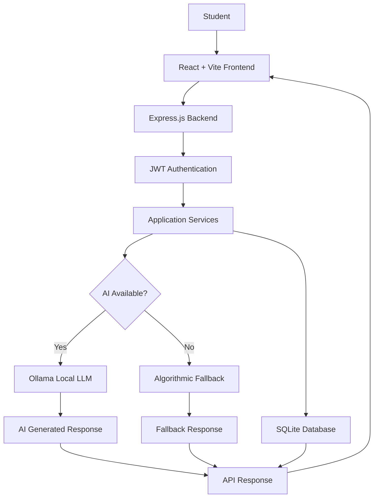

# 🧠 StudyBuddy

### AI-Powered Study Planning & Progress Tracking Platform

<p align="center">
  
  
  
  
  
  
</p>

<p align="center">
  <strong>Study Smarter. Stay Consistent. Panic Less. 🚀</strong>
</p>

<p align="center">
  A full-stack AI-assisted academic productivity platform that helps students organize subjects, generate personalized study schedules, track learning progress, and receive intelligent study assistance.
</p>

<p align="center">
  <a href="https://studybuddy-nyrg.onrender.com/">🌐 Live Application</a> •
  <a href="https://github.com/rajrohit5783-cmyk/StudyBuddy">📂 GitHub Repository</a>
</p>

---

## 📌 Table of Contents

- [Overview](#-overview)
- [Why StudyBuddy?](#-why-studybuddy)
- [Application Preview](#-application-preview)
- [Features](#-features)
- [Technology Stack](#-technology-stack)
- [System Architecture](#-system-architecture)
- [Intelligent Study Planner](#-intelligent-study-planner)
- [Database Design](#-database-design)
- [API Documentation](#-api-documentation)
- [Installation](#-installation-and-setup)
- [Environment Configuration](#-environment-configuration)
- [Testing](#-testing)
- [Project Structure](#-project-structure)
- [Security](#-security-and-reliability)
- [Future Enhancements](#-future-enhancements)
- [Contributors](#-project-team)
- [Acknowledgements](#-acknowledgements)

---

## 🌐 Overview

**StudyBuddy** is an AI-assisted study planning and academic productivity application developed to make student learning more organized, structured, and measurable.

Students often struggle with:

- Managing multiple subjects simultaneously.
- Prioritizing topics before examinations.
- Maintaining consistent study schedules.
- Identifying unfinished syllabus topics.
- Tracking actual study time.
- Revising previously learned concepts.
- Finding reliable guidance when they get stuck.

StudyBuddy addresses these challenges by bringing academic planning, progress monitoring, focused study sessions, revision tools, and AI-powered assistance into a unified platform.

Instead of functioning as just another task manager, StudyBuddy focuses on the entire study workflow:

**Plan → Study → Track → Revise → Improve**

---

## 🎯 Why StudyBuddy?

| Traditional Study Methods | StudyBuddy |
|---|---|
| Manual timetable creation | AI-assisted study planning |
| Unorganized subject tracking | Centralized subject management |
| Difficult to prioritize topics | Exam and confidence-based prioritization |
| No structured progress overview | Topic-level progress tracking |
| Separate revision tools | Integrated flashcards and quizzes |
| Searching for study guidance | Interactive AI Study Coach |
| Manual study-time tracking | Focus sessions and analytics |

---

## 🖥️ Application Preview

StudyBuddy provides a clean, modern interface with a minimal design and an interactive workspace.

### 1. Dashboard

The dashboard provides a centralized overview of academic activity, including completed topics, study time, sessions, flashcards, subjects, and upcoming examinations.


### 2. AI-Generated Study Plan

Generate structured study schedules based on available study hours, examination dates, topic completion, subject confidence, and difficulty.


### 3. AI Study Coach

An interactive academic assistant that helps students understand concepts, prioritize subjects, and develop realistic study plans.


> **Screenshot setup:** Upload your three actual screenshots to `docs/images/` using these exact filenames:
>
> - `dashboard.png`
> - `study-plan.png`
> - `ai-coach.png`
>
> Until these files are committed to GitHub, the preview images will not appear.

---

## ✨ Features

### 📊 1. Interactive Dashboard

- Overview of academic preparation.
- Completed-topic statistics.
- Total study-time calculation.
- Study-session tracking.
- Flashcards due for revision.
- Upcoming examination information.
- Quick navigation to important modules.

### 📚 2. Subject Management

- Create and manage subjects.
- Add syllabus topics.
- Set examination dates.
- Assign subject difficulty.
- Maintain confidence levels.
- Mark individual topics as completed.
- Monitor subject preparation.

### 🤖 3. Intelligent Study Planner

StudyBuddy provides two study-planning paths:

**AI-Based Planning**
- Uses a locally hosted Ollama model.
- Generates structured study schedules.
- Considers available hours and subject information.
- Produces topic-based study sessions.

**Algorithmic Fallback**
- Works when AI generation is unavailable.
- Prioritizes subjects using examination proximity.
- Considers confidence and difficulty.
- Accounts for unfinished topics.
- Respects daily study-time limits.

### ⏱️ 4. Pomodoro Focus Timer

- Structured study sessions.
- Focus-oriented learning workflow.
- Session completion tracking.
- Recorded study duration.

### 🗂️ 5. Flashcard System

- Create question-and-answer flashcards.
- Review learning material.
- Track revision activity.
- Schedule subsequent reviews using an interval and ease-based review mechanism.

### 📝 6. AI-Assisted Quiz Generation

- Generate multiple-choice questions.
- Select a subject and relevant topics.
- Configure the number of questions.
- Receive answer explanations.
- Use built-in fallback questions when AI generation fails.

### 🧠 7. AI Study Coach

- Interactive chat interface.
- Academic explanations.
- Study prioritization.
- Revision suggestions.
- Contextual conversation history.
- Local AI with fallback guidance.

### 📄 8. PDF Document Processing

- Upload syllabus PDFs.
- Extract document text.
- Store document metadata.
- Generate flashcards from extracted text.

### 📈 9. Academic Analytics

- Total study duration.
- Completed study sessions.
- Study streak.
- Weekly study activity.
- Subject-wise topic completion.
- Recent study history.

### 🌙 10. Theme Customization

- Light theme.
- Dark theme.
- Persistent theme preference.

### 📅 11. Calendar Export

- Export generated study schedules.
- Download calendar events in `.ics` format.
- Import supported calendar files into compatible calendar applications.

---

## ⚙️ Technology Stack

StudyBuddy uses a modern JavaScript-based full-stack architecture.

### Frontend Technologies

| Technology | Implementation |
|---|---|
| React.js 18 | Component-based UI development |
| Vite 5 | Frontend development and build tooling |
| JavaScript ES Modules | Application logic |
| HTML5 | Semantic application structure |
| CSS3 | Responsive styling and themes |
| Lucide React | Interface icons |

### Backend Technologies

| Technology | Implementation |
|---|---|
| Node.js | Server-side JavaScript runtime |
| Express.js 4 | REST API and routing |
| JWT | User authentication |
| bcryptjs | Password hashing |
| Multer | PDF file uploads |
| pdf-parse | PDF text extraction |
| Helmet | HTTP security headers |
| CORS | Cross-origin request configuration |
| express-rate-limit | API request limiting |
| dotenv | Environment configuration |

### Database

| Technology | Purpose |
|---|---|
| SQLite | Persistent application storage |
| Node.js `node:sqlite` | Built-in SQLite database interface |
| JSON serialization | Application state persistence |

### Artificial Intelligence

| Technology | Purpose |
|---|---|
| Ollama | Local AI model runtime |
| Llama 3.2 (1B) | Default configured language model |
| Ollama Chat API | AI planning, coaching and quiz generation |
| Algorithmic Planner | Non-AI scheduling fallback |

### Development Tools

- Git
- GitHub
- npm
- VS Code
- Postman

---

## 🏗️ System Architecture

StudyBuddy follows a client-server architecture with a local AI integration layer.



### Architecture Components

**1. Frontend Layer**

Built using React and Vite.

Responsibilities:
- Render application pages.
- Manage user interactions.
- Display study analytics.
- Communicate with backend APIs.
- Manage authentication state.

**2. Backend Layer**

Built using Node.js and Express.

Responsibilities:
- Handle HTTP requests.
- Authenticate users.
- Validate incoming data.
- Manage academic operations.
- Coordinate AI requests.
- Process uploaded documents.

**3. Database Layer**

Uses SQLite through Node.js's built-in `node:sqlite` module.

Responsibilities:
- Store user information.
- Store subjects and topics.
- Maintain study sessions.
- Store flashcards and quizzes.
- Save study plans and documents.

**4. AI Layer**

Uses Ollama for local language-model execution.

Responsibilities:
- Generate study plans.
- Answer academic questions.
- Generate quiz questions.

**5. Fallback Layer**

Uses a deterministic algorithm for study planning and predefined fallback responses for selected AI-powered operations.

---

## 🧮 Intelligent Study Planner

One of StudyBuddy's most important components is its intelligent scheduling engine.

The system combines AI-assisted scheduling with a deterministic fallback algorithm.

### Priority Calculation

The algorithm evaluates subject priority using the following factors:

- Examination proximity.
- Subject confidence.
- Subject difficulty.
- Number of unfinished topics.

The implemented priority score is:

\[
P(s)=\frac{100}{D+2}+(100-C)\times0.65+H+2U
\]

Where:

| Variable | Meaning |
|---|---|
| \(P(s)\) | Subject priority score |
| \(D\) | Days until examination |
| \(C\) | Subject confidence (0–100) |
| \(H\) | Difficulty contribution |
| \(U\) | Number of unfinished topics |

Difficulty contribution:

| Difficulty | Score |
|---|---:|
| Easy | 0 |
| Medium | 8 |
| Hard | 16 |

### Scheduling Workflow

1. Retrieve the user's subjects and syllabus topics.
2. Identify unfinished topics.
3. Calculate subject priority scores.
4. Sort subjects by priority.
5. Allocate available study time.
6. Generate study slots for the selected planning horizon.
7. Save and return the generated schedule.

The fallback planner supports a planning horizon of up to 30 days and constrains its daily time budget.

### AI Planning Workflow

When AI planning is enabled:

1. The backend prepares the subject information.
2. The information is sent to the configured Ollama model.
3. Ollama generates a structured JSON response.
4. The backend validates the generated schedule.
5. The resulting plan is saved.

If AI generation fails, the deterministic planner is used instead.

---

## 🗄️ Database Design

StudyBuddy uses SQLite for persistent storage.

The database is initialized through the `server/store.js` module.

The application maintains the following logical data collections:

| Collection | Stored Information |
|---|---|
| Users | Account details and password hashes |
| Subjects | Subject name, exam date, confidence and difficulty |
| Sessions | Completed study sessions and durations |
| Flashcards | Questions, answers and revision information |
| Chats | AI Coach conversation records |
| Quizzes | Generated quiz information |
| Documents | Uploaded PDF metadata and extracted text |
| Plans | Generated study schedules |

### Data Persistence

- SQLite stores the application state.
- The database uses a single state record.
- Application data is serialized as JSON within the SQLite database.
- WAL mode is enabled for database operation.
- The application can migrate existing JSON state into SQLite during initialization.

---

## 🔌 API Documentation

StudyBuddy exposes RESTful API endpoints through its Express backend.

All protected routes require a valid JWT access token.

### Authentication

| Method | Endpoint | Description |
|---|---|---|
| POST | `/api/auth/register` | Register a new account |
| POST | `/api/auth/login` | Authenticate a user |
| GET | `/api/auth/me` | Retrieve authenticated user information |

### Dashboard and Data

| Method | Endpoint | Description |
|---|---|---|
| GET | `/api/bootstrap` | Retrieve the user's application data |
| GET | `/api/health` | Check server and Ollama availability |
| GET | `/api/subjects` | Retrieve subjects |

### Subject Management

| Method | Endpoint | Description |
|---|---|---|
| POST | `/api/subjects` | Create a subject |
| PUT | `/api/subjects/:id` | Update a subject |
| DELETE | `/api/subjects/:id` | Delete a subject |

### Study Planning

| Method | Endpoint | Description |
|---|---|---|
| POST | `/api/plan` | Generate and save a study plan |
| GET | `/api/calendar.ics` | Export the latest plan as an ICS calendar |

### Study Sessions

| Method | Endpoint | Description |
|---|---|---|
| POST | `/api/sessions` | Record a completed session |
| DELETE | `/api/sessions/:id` | Delete a study session |

### Flashcards

| Method | Endpoint | Description |
|---|---|---|
| GET | `/api/flashcards` | Retrieve flashcards |
| POST | `/api/flashcards` | Create a flashcard |
| POST | `/api/flashcards/:id/review` | Record a flashcard review |

### AI Services

| Method | Endpoint | Description |
|---|---|---|
| POST | `/api/coach` | Generate an AI Coach response |
| POST | `/api/quiz` | Generate quiz questions |

### Document Processing

| Method | Endpoint | Description |
|---|---|---|
| POST | `/api/documents` | Upload and extract a PDF |
| POST | `/api/documents/:id/flashcards` | Generate flashcards from a document |

### Analytics

| Method | Endpoint | Description |
|---|---|---|
| GET | `/api/analytics` | Retrieve academic analytics |

---

## 🚀 Installation and Setup

Follow these instructions to run StudyBuddy locally.

### Prerequisites

| Requirement | Version |
|---|---|
| Node.js | 22.5 or newer |
| npm | Included with Node.js |
| Git | Latest stable version |
| Ollama | Optional, for local AI features |

### Step 1 — Clone the Repository

```bash
git clone https://github.com/rajrohit5783-cmyk/StudyBuddy.git
```

### Step 2 — Navigate to the Project

```bash
cd StudyBuddy
```

### Step 3 — Install Dependencies

```bash
npm install
```

### Step 4 — Configure Environment Variables

Create a `.env` file in the project root.

```env
PORT=8787
NODE_ENV=development

JWT_SECRET=replace_with_a_secure_random_secret_at_least_32_characters

OLLAMA_URL=http://127.0.0.1:11434
OLLAMA_MODEL=llama3.2:1b

DATA_DIR=./data
UPLOAD_DIR=./uploads
MAX_UPLOAD_MB=10

CORS_ORIGINS=http://localhost:5173
```

Use a strong, private JWT secret. Never commit your actual `.env` file to GitHub.

### Step 5 — Configure Ollama

Download Ollama:

https://ollama.com/

Pull the configured model:

```bash
ollama pull llama3.2:1b
```

Start the Ollama service.

The application can still use its fallback functionality when Ollama is unavailable.

### Step 6 — Start StudyBuddy

Run:

```bash
npm run dev
```

This command starts:

- Vite frontend server.
- Express backend server.

### Step 7 — Open the Application

```text
Frontend: http://localhost:5173
Backend:  http://localhost:8787
```

You can now create an account and start using StudyBuddy.

---

## 🧪 Testing

StudyBuddy includes automated tests for its deterministic scheduling algorithm.

Run the test suite:

```bash
npm test
```

Run the project checks:

```bash
npm run check
```

The existing planner tests cover:

- Planning horizon constraints.
- Daily study-time budget limits.
- Subject prioritization.
- Handling empty subject collections.
- Invalid and excessive planning inputs.

---

## 📂 Project Structure

```text
StudyBuddy/
│
├── public/
│
├── src/
│   ├── main.jsx
│   └── styles.css
│
├── server/
│   ├── index.js
│   ├── planner.js
│   └── store.js
│
├── tests/
│   └── planner.test.js
│
├── docs/
│   └── images/
│       ├── dashboard.png
│       ├── study-plan.png
│       └── ai-coach.png
│
├── data/
│   └── studybuddy.sqlite
│
├── uploads/
│
├── index.html
├── vite.config.js
├── package.json
├── package-lock.json
├── .gitignore
├── .env
└── README.md
```

*Note: `data/`, `uploads/`, and `.env` are runtime/configuration locations, not files that should be committed with private data. The screenshot folder must be added by the project team.*

---

## 🔐 Security and Reliability

StudyBuddy incorporates several backend security and reliability mechanisms.

| Mechanism | Implementation |
|---|---|
| Authentication | JSON Web Tokens |
| Password Protection | bcryptjs password hashing |
| HTTP Security | Helmet |
| API Protection | Express Rate Limit |
| Cross-Origin Security | CORS origin validation |
| Upload Restrictions | PDF-only upload filtering |
| Upload Size Limit | Configurable maximum upload size |
| User Data Isolation | Authenticated user ownership checks |
| AI Timeout | 25-second request timeout |
| Database Reliability | SQLite WAL mode |

### Important Security Notes

- Configure a strong JWT secret before production deployment.
- Do not expose private environment variables.
- Use persistent storage for the SQLite database in deployment.
- Configure allowed CORS origins carefully.
- Keep uploaded documents and user data protected.
- Back up the application database regularly.

---

## 🚧 Future Enhancements

StudyBuddy is designed to be extensible. Potential improvements include:

- [ ] Advanced spaced-repetition algorithms.
- [ ] More detailed learning analytics.
- [ ] Study streak achievements and gamification.
- [ ] Automated study reminders.
- [ ] Improved quiz performance analysis.
- [ ] Calendar synchronization.
- [ ] Enhanced mobile experience.
- [ ] Additional AI model support.
- [ ] More detailed subject performance insights.
- [ ] Automated end-to-end testing.

---

## 👨‍💻 Project Team

Developed as a Major Project at **JECRC University, Jaipur, Rajasthan, India**.

| Team Member | Registration Number |
|---|---|
| Vivek Rankawat | 25BCON2395 |
| Rohit Raj | 25BCON1900 |
| Rudraksh Pitti | 25BCON2488 |

**Under the Supervision of:** Harshit Gupta  
**Designation:** AI Trainer

---

## 🙌 Acknowledgements

We would like to express our gratitude to our project supervisor, **Harshit Gupta**, for his guidance and support throughout the development of StudyBuddy.

We also acknowledge the open-source communities behind React, Node.js, Express, SQLite, Vite, and Ollama for providing the technologies that made this project possible.

---

## 💡 Our Philosophy

> "Small, consistent sessions beat last-minute panic."

StudyBuddy is built around the belief that academic success is not only about studying longer, but also about studying with clarity, consistency, and purpose.

**Plan your work. Focus deeply. Track your progress. Make every study session count.**

<p align="center">
  <strong>🧠 StudyBuddy — Study Smarter. Panic Less. 🎯</strong>
</p>

<p align="center">
  Made with 💜 by the StudyBuddy Team
</p>
